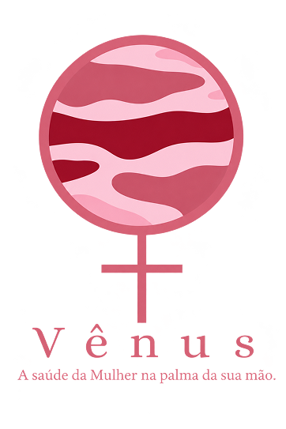

<div align="center">



# Vênus · Portal do Profissional

**Plataforma de conteúdo e informação em saúde da mulher, feita para profissionais de saúde.**


[Sobre](#-sobre-o-projeto) ·
[Funcionalidades](#-funcionalidades) ·
[Tecnologias](#-tecnologias) ·
[Instalação](#-instalação) ·
[Configuração do .env](#-configuração-do-env) ·
[Estrutura](#-estrutura-do-projeto)

</div>

---

## 💗 Sobre o projeto

O **Vênus** é um portal onde profissionais de saúde criam e publicam conteúdo educativo sobre a saúde da mulher. Todo conteúdo passa por uma **revisão editorial** antes de ser publicado: o profissional escreve, envia para revisão, e a publicação acontece apenas depois da moderação.

O portal também traz uma **agenda de datas de saúde** (Agosto Lilás, Setembro Amarelo, Outubro Rosa, Novembro Azul, 8 de março e outras) com sugestões de pauta, para ajudar a planejar o calendário editorial.

---

## ✨ Funcionalidades

| Área | O que faz |
| --- | --- |
| 🔐 **Conta** | Cadastro em etapas, login, perfil, alteração de senha e recuperação de senha por e-mail |
| 🗓️ **Agenda de datas de saúde** | Campanhas e datas importantes dos próximos 12 meses, com sugestão de pauta e botão para criar conteúdo |
| ✍️ **Conteúdos** | Criação e edição por categoria e formato (artigo, vídeo, infográfico), com fluxo: rascunho → em revisão → publicado ou recusado |
| 📰 **Publicações** | Visualizar, editar, duplicar, arquivar e excluir o que já foi publicado |
| 📊 **Relatórios** | Publicações, status, categorias e alcance (visualizações e curtidas), com exportação em **PDF** e **CSV** |
| 💬 **Caixa de entrada** | Conversas e mensagens com as usuárias |
| ⭐ **Feedback** | Acompanhamento das avaliações recebidas |
| ⚙️ **Configurações e suporte** | Preferências da conta e canal de ajuda |

---

## 🧰 Tecnologias

- **Backend:** PHP 8.2 · Laravel 12
- **Banco de dados:** MySQL
- **Frontend:** Blade · CSS · JavaScript puro
- **Fonte:** Poppins (Google Fonts)

---

## 🚀 Instalação

### Pré-requisitos

- [PHP 8.2+](https://www.php.net/downloads) com as extensões padrão do Laravel
- [Composer](https://getcomposer.org/)
- [MySQL](https://www.mysql.com/) (ou MariaDB)
- [Node.js](https://nodejs.org/) e npm, se for compilar os assets

### Passo a passo

```bash
# 1. Clone o repositório
git clone https://github.com/SEU-USUARIO/SEU-REPOSITORIO.git
cd SEU-REPOSITORIO

# 2. Instale as dependências PHP
composer install

# 3. Crie o arquivo .env (veja a próxima seção) e gere a chave da aplicação
cp .env.example .env
php artisan key:generate

# 4. Crie o banco de dados no MySQL
#    CREATE DATABASE dbvenus CHARACTER SET utf8mb4 COLLATE utf8mb4_unicode_ci;

# 5. Rode as migrations e os seeders
php artisan migrate
php artisan db:seed --class=ConteudoSeeder
php artisan db:seed --class=DataSaudeSeeder

# 6. Suba o servidor local
php artisan serve
```

Acesse em **http://127.0.0.1:8000**.

---

## 🔧 Configuração do .env

O arquivo `.env` guarda as configurações e senhas do seu ambiente. **Ele não deve ir para o GitHub.** Confirme que o `.gitignore` contém a linha `.env`.

Cole abaixo o conteúdo do seu `.env` **sem senhas, chaves ou tokens reais**, apenas como modelo para quem for rodar o projeto:

```env
APP_NAME=Laravel
APP_ENV=local
APP_KEY=base64:EKvnAllVFbtWUUjkOoKjG7vkECfgUCDwi3IVrqKAVIQ=
APP_DEBUG=true
APP_URL=http://localhost

APP_LOCALE=en
APP_FALLBACK_LOCALE=en
APP_FAKER_LOCALE=en_US

APP_MAINTENANCE_DRIVER=file
# APP_MAINTENANCE_STORE=database

# PHP_CLI_SERVER_WORKERS=4

BCRYPT_ROUNDS=12

LOG_CHANNEL=stack
LOG_STACK=single
LOG_DEPRECATIONS_CHANNEL=null
LOG_LEVEL=debug

DB_CONNECTION=mysql
DB_HOST=127.0.0.1
DB_PORT=3306
DB_DATABASE=dbvenus
DB_USERNAME=root
DB_PASSWORD=

SESSION_DRIVER=database
SESSION_LIFETIME=120
SESSION_ENCRYPT=false
SESSION_PATH=/
SESSION_DOMAIN=null

BROADCAST_CONNECTION=log
FILESYSTEM_DISK=local
QUEUE_CONNECTION=database

CACHE_STORE=database
# CACHE_PREFIX=

MEMCACHED_HOST=127.0.0.1

REDIS_CLIENT=phpredis
REDIS_HOST=127.0.0.1
REDIS_PASSWORD=null
REDIS_PORT=6379

MAIL_MAILER=smtp
MAIL_HOST=smtp.gmail.com
MAIL_PORT=587
MAIL_USERNAME=venus.saudemulher@gmail.com
MAIL_PASSWORD=Está com a Lívia
MAIL_ENCRYPTION=tls
MAIL_FROM_ADDRESS=venus.saudemulher@gmail.com
MAIL_FROM_NAME="Vênus"

AWS_ACCESS_KEY_ID=
AWS_SECRET_ACCESS_KEY=
AWS_DEFAULT_REGION=us-east-1
AWS_BUCKET=
AWS_USE_PATH_STYLE_ENDPOINT=false

VITE_APP_NAME="${APP_NAME}"

```

---

## 🔄 Fluxo de um conteúdo

```text
 Rascunho ──► Em revisão ──► Publicado
                  │
                  └──────► Recusado ──► (editar e reenviar)
```

Nenhum conteúdo é publicado sozinho: a decisão final é sempre da moderação.

---

## 🛣️ Próximos passos

- [ ] Campo **data planejada** nos conteúdos, para organizar o calendário editorial
- [ ] Botão **Criar conteúdo** da agenda abrindo o formulário com a categoria já escolhida
- [ ] Tela de administração para cadastrar novas datas e campanhas de saúde

---

## 📸 Telas

> Adicione aqui capturas de tela do projeto.
>
> ``

---

## 👩‍💻 Autoria

Feito por **Leonni Cruz e Lívia de Oliveira**.

[](https://github.com/LeonniCr)

[](https://github.com/Liv288)

<div align="center">

Vênus · A Saúde da Mulher 💗

</div>
